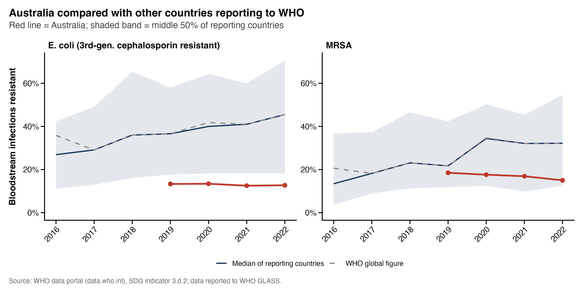

# Antimicrobial-Resistant Bloodstream Infections: Australia Compared with the World

An R analysis of the two WHO antimicrobial resistance (AMR) indicators used to monitor **Sustainable Development Goal indicator 3.d.2**, with a focus on Australia:

1. *E. coli* bloodstream infections resistant to third-generation cephalosporins (%)
2. Bloodstream infections due to methicillin-resistant *Staphylococcus aureus* (MRSA) (%)

The data come from the WHO data portal and were compiled from national data reported to the WHO Global Antimicrobial Resistance and Use Surveillance System (GLASS).



## Questions explored

- How does Australia compare with the global figure, all reporting countries, and high-income peers?
- Is resistance changing over time *within* countries? This uses fixed-effects and mixed-effects models on the logit scale.
- Are the trend estimates robust to changes in which countries report, to record length, and to how 0% and 100% values are handled?
- Did resistance shift between 2019 and the COVID-19 period (2021–22)?
- Is resistance associated with national characteristics, such as GDP, health spending, UHC coverage, out-of-pocket spending, sanitation and antibiotic use? These are exploratory, ecological associations.
- Do *E. coli* and MRSA resistance move together? Are there distinct country "AMR profiles"? Do neighbouring countries have similar levels (Moran's I)?
- Could patterns in reporting itself bias the global picture?
- How well do short-term model predictions perform against a simple "last value" baseline?

## Project structure

```
AMR_glass/
├── AMR_glass.Rproj          # Open this in RStudio
├── amr_sdg_3d2_analysis.R   # The full analysis (Parts 1–3)
├── data/                    # Input data (see data/README.md)
├── figures/                 # Charts created by the script (PNG, optional PDF)
└── tables/                  # Result tables created by the script (CSV, TXT)
```

## How to run

1. Install [R](https://cran.r-project.org/) (version 4.2 or newer) and [RStudio](https://posit.co/download/rstudio-desktop/).
2. Download or clone this repository.
3. Download the two WHO indicator files into `data/`, as described in [`data/README.md`](data/README.md).
4. Open `AMR_glass.Rproj` in RStudio, then open and run `amr_sdg_3d2_analysis.R`.

Missing R packages are installed automatically on the first run. On the first run, the script also downloads World Bank indicators with the `WDI` package and caches them in `data/`, so you will need an internet connection.

**Optional inputs:**
- **Antibiotic consumption:** Section 25 runs only if `data/antibiotic_use.csv` is present.
- **Australian national data:** Section 29 runs once the AURA/AGAR figures are entered into `national_data` in the script.

## Methods in brief

- **Trends:** Linear models of logit(resistance) with country fixed effects, using country-clustered standard errors. A mixed-effects model (`lme4`) is also fitted with a prespecified rule for simplifying its structure, followed by residual and leave-one-country-out diagnostics.
- **Sensitivity analyses:** These vary the minimum years of data per country (3–5), the logit boundary adjustment (0.1%, 0.5%, 1%, or excluding endpoints), and the cohort of countries included (all eligible countries or fixed reporting cohorts).
- **Associations:** Spearman correlations and multivariable logit-scale regressions on country averages.
- **Profiles:** k-means clustering, with the number of clusters chosen by silhouette width and stability checked by subsampling (adjusted Rand index).
- **Spatial analysis:** Moran's I based on shared land borders, tested by permutation.
- **Prediction:** Rolling-origin backtesting against a persistence baseline. Short illustrative scenarios are shown, but they are not forecasts.

## Limitations

- Values are crude percentages reported by each country. Numbers of patients tested are not published, so confidence intervals for individual values cannot be calculated.
- From 2020, WHO only shows countries that reported at least 10 bloodstream infections with susceptibility results.
- The set of reporting countries changes from year to year, and surveillance is not always nationally representative.
- Country-level associations are ecological. They do not support causal or patient-level conclusions.

A full list of limitations is written to `tables/28_interpretation_limits.txt` each time the script runs.

## Data sources and licences

- **WHO data portal** ([data.who.int](https://data.who.int)), SDG indicator 3.d.2, data reported to WHO GLASS. Licence: CC BY 4.0.
- **World Bank World Development Indicators**, accessed with the `WDI` R package. Licence: CC BY 4.0.

The code in this repository is released under the MIT Licence (see `LICENSE`).

## Author

**Kushal Baraily**, October 2026
